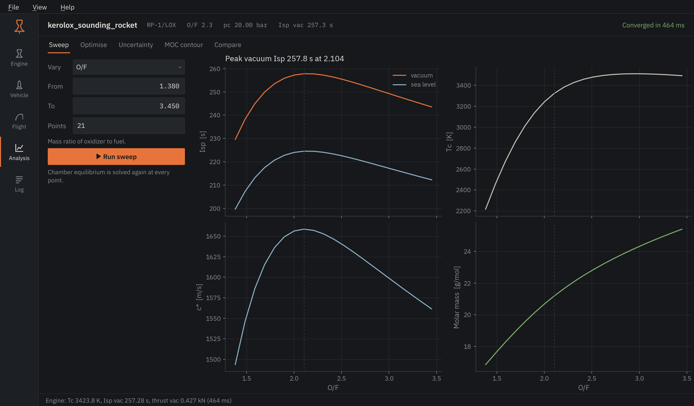
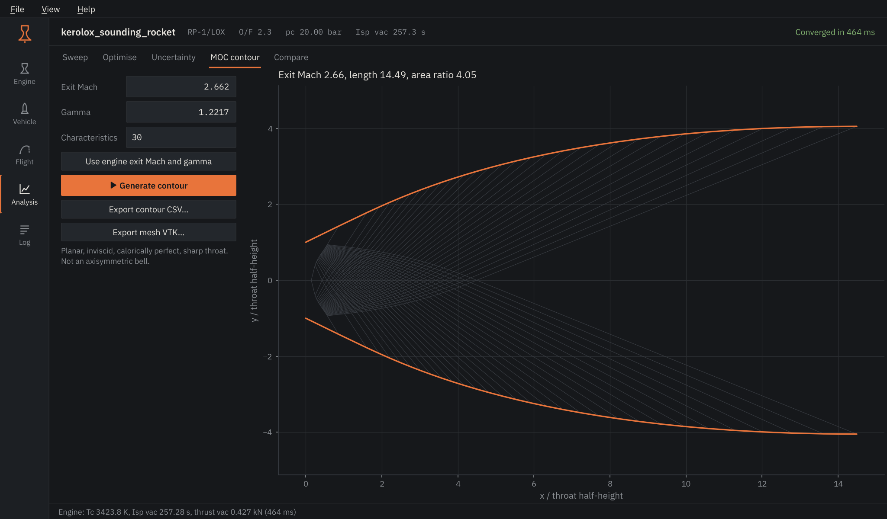

# Analysis

The Analysis page collects the studies that run many engine or vehicle
evaluations. Each tab has its own inputs and its own run button.

## Sweep

<figure markdown>

</figure>

Vary O/F, chamber pressure or area ratio over a range; everything else comes
from the Engine page. The chamber equilibrium is solved again at every point,
so an O/F sweep shows the real shift of temperature and molar mass. The dashed
line marks the point of highest vacuum Isp.

## Optimise

Four problems behind one selector:

- **Nozzle area ratio** for a weighted mix of vacuum and lower-altitude thrust
  coefficient, using the engine's chamber pressure and gamma.
- **Engine design point**: the chamber pressure and O/F that reach a target
  Isp, and the throat area that then gives the target thrust.
- **Stage propellant split** that maximises ideal delta-v for a fixed total
  propellant mass.
- **Gravity-turn ascent**: kick-off altitude, kick angle and pitch rate that
  bring a point-mass vehicle to a target altitude under a dynamic-pressure
  limit.

The table lists the optimum; the plot shows how the objective converged.

## Uncertainty

Samples chamber pressure, throat area and gamma around the last engine run and
propagates them through the nozzle relations. Thrust and Isp histograms,
means and standard deviations follow; with a minimum thrust set, the share of
samples above it is reported as reliability.

## MOC contour

<figure markdown>

</figure>

A minimum-length nozzle by the method of characteristics, for a given exit Mach
number and gamma (*Use engine exit Mach and gamma* fills them from the last
run). The contour is planar and two-dimensional: a design aid for studying the
expansion fan, not the axisymmetric bell the Engine page uses. Export the wall
as CSV or the characteristic net as VTK.

## Compare

*Pin current result* stores the last engine result under a label. With two or
more pinned, the table and the bar chart put them side by side.
