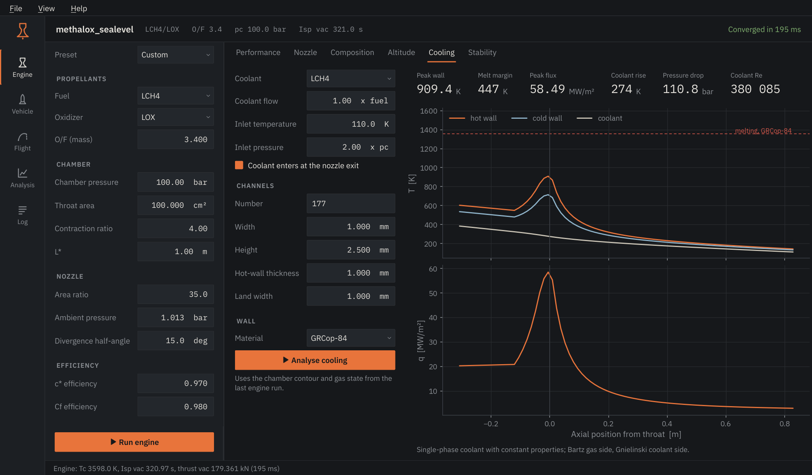

# Engine

The Engine page turns an operating point into chamber state and nozzle
performance. `F5` runs it; one point takes about a tenth of a second.

<figure markdown>

</figure>

## Inputs

| Input | Meaning |
|---|---|
| Preset | Loads a reference operating point. Editing any field returns it to *Custom*. |
| Fuel, Oxidizer | Propellants in their storage state. LH2, LCH4 and LOX enter at their boiling points; RP-1, the hydrazines, NTO and HTP as liquids at 298 K. Hover a name for details. |
| O/F | Oxidizer-to-fuel **mass** ratio. |
| Chamber pressure | Stagnation pressure at the injector end. |
| Throat area | Sets thrust and mass flow. Isp and c* do not depend on it. |
| Contraction ratio, L* | Chamber geometry: chamber-to-throat area and characteristic length (chamber volume over throat area). They shape the contour, the cooling analysis and the acoustic modes. |
| Area ratio | Nozzle exit-to-throat area, ε. |
| Ambient pressure | Back pressure for the *Operating* column. Vacuum and sea level are always shown as well. |
| Divergence half-angle | Momentum thrust is multiplied by (1 + cos α) / 2. Set 0 for an ideal contoured nozzle. |
| c* and Cf efficiency | Multipliers on the ideal characteristic velocity and thrust coefficient. Typical values are 0.95-0.99. |

## Views

**Performance.** Vacuum and sea-level Isp, vacuum thrust, c*, chamber
temperature and mass flow. The plot follows pressure, temperature and Mach
number along the actual wall contour, from the injector face (left) to the
exit. The table lists the three back-pressure cases side by side; when the
operating point is strongly over-expanded (exit-to-ambient pressure below 0.4)
a note warns that the real nozzle would separate.

**Nozzle.** The wall contour: a cylindrical chamber sized from L*, a 30°
convergence with a 1.5 Rt throat arc, and an 80 % Rao bell.
*Export contour* writes the coordinates as CSV or the surface of revolution as
an STL mesh. *3D view* opens an interactive model coloured by Mach number,
temperature or pressure (needs PyVista and OpenGL).

**Composition.** Mole fractions in the chamber on a logarithmic scale, down to
10-4.

**Altitude.** Thrust and Isp through the US Standard Atmosphere up to 80 km,
with the matched-expansion altitude marked and the band where flow separation
is likely shaded.

**Cooling.** Regenerative cooling of the current contour; see below.

**Stability.** Longitudinal, tangential and radial acoustic modes of the
chamber and an estimate of the feed-system (chug) frequency.

## Cooling

<figure markdown>

</figure>

The coolant defaults to the fuel when it is in the coolant table. The channel
count defaults to as many channels as fit around the throat at the given width
and land. The jacket is the full chamber and nozzle length.

Read the result from left to right: peak hot-wall temperature, its margin to
the melting point of the chosen alloy, peak heat flux, coolant temperature
rise and pressure drop, and the coolant Reynolds number. A Reynolds number
below 2300 means laminar coolant flow, which removes heat poorly; small engines
need fewer, narrower channels than their size suggests.

!!! warning "What the cooling model leaves out"
    Coolant properties are constant along the channel, there is no boiling or
    supercritical behaviour, and wall conduction is one-dimensional. Treat the
    result as a sizing estimate. [Theory](../theory/cooling.md) has the details.
