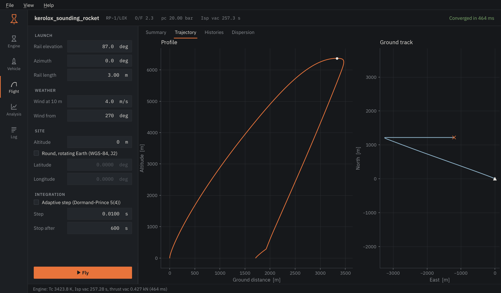
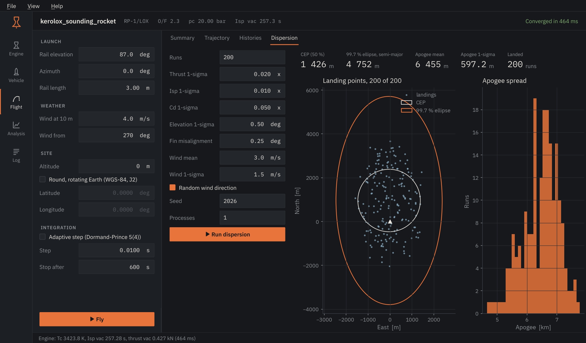

# Flight

The Flight page flies the project's vehicle with the last engine result, in six
degrees of freedom, from the launch rail to impact. If the engine has not been
run yet, `F5` runs it first.

<figure markdown>

</figure>

## Inputs

| Input | Notes |
|---|---|
| Rail elevation, azimuth | 90° is vertical; azimuth is clockwise from north. |
| Rail length | Attitude is held until the vehicle has travelled this far. |
| Wind at 10 m, wind from | Meteorological direction (where the wind comes from). Wind grows with height as a 1/7 power law up to 1 km and stays constant above. |
| Site altitude | Height of the pad. |
| Round, rotating Earth | Integrates in an Earth-centred inertial frame with WGS-84 and J2 gravity, at the given latitude and longitude. Off, the Earth is flat with inverse-square gravity, which is accurate for sounding-rocket ranges. |
| Integration | Fixed-step RK4 or adaptive Dormand-Prince 5(4), the step, and when to stop. |

## Views

**Summary.** Apogee, maximum speed and Mach number, maximum sensed
acceleration, maximum dynamic pressure and distance from the pad at landing,
followed by an event table: liftoff, burnout, apogee, parachute openings and
impact.

**Trajectory.** Altitude against ground distance, and the ground track seen
from above.

**Histories.** Altitude, Mach number, thrust and drag, and angle of attack
against time. The dashed line marks apogee.

## Dispersion

<figure markdown>

</figure>

A Monte Carlo study repeats the flight with thrust, Isp, drag coefficient, rail
elevation, fin misalignment and wind drawn from the distributions on the left.
The result is the landing scatter with the circle that holds half of the
landings (CEP) and the 99.7 % covariance ellipse, plus the spread of apogee.

*Processes* above 1 runs the cases in parallel worker processes; 1 keeps them
inside the application. Only flights that reach the ground before the time
limit count as landings; the rest still contribute to the apogee statistics.

!!! note "Reading a dispersion"
    The scatter is only as good as the input distributions. Use measured
    motor-to-motor variation and a wind forecast for the launch day, not the
    defaults, before using an ellipse to set a recovery area.
