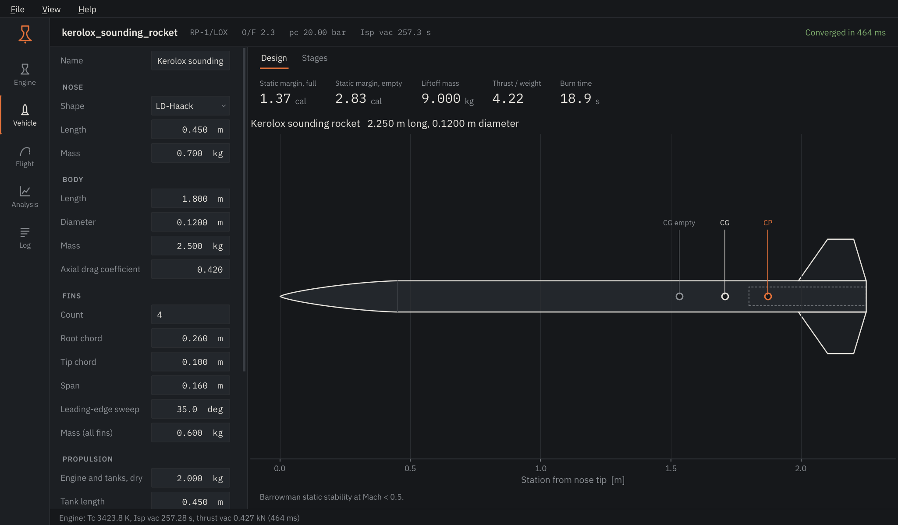
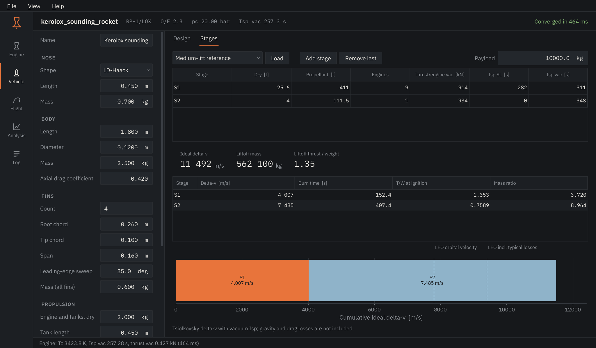

# Vehicle

The Vehicle page describes the airframe that the Flight page flies, and has a
separate calculator for multi-stage launch vehicles.

<figure markdown>

</figure>

## Design

The drawing updates as you type. Circles mark the centre of gravity with full
tanks, with empty tanks, and the centre of pressure.

| Input | Notes |
|---|---|
| Nose | Shape (conical, tangent ogive, elliptical, parabolic, LD-Haack), length and mass. The nose diameter follows the body. |
| Body | Length, diameter, mass and the axial drag coefficient used in flight. |
| Fins | Count, root and tip chord, span, leading-edge sweep and the mass of the whole set. |
| Propulsion | Dry mass of engine and tanks, tank length and propellant mass. The propellant is split into fuel and oxidizer at the engine's O/F. |
| Recovery | Main parachute diameter and drag coefficient, and with dual deployment a drogue that opens at apogee while the main waits for a set altitude. |

**Static margin** is the distance from CG to CP in body diameters (calibres),
for full and empty tanks. Between 1 and 2 calibres is a common target. Below 1
the rocket may not recover from a gust; well above 2 it turns strongly into the
wind. **Thrust / weight** uses the sea-level thrust of the last engine run, and
**burn time** the propellant mass over the engine mass flow.

The centre of pressure comes from the Barrowman equations, which hold for
small angles of attack at subsonic speed.

## Stages

<figure markdown>

</figure>

Each row is a stage, bottom first: dry and propellant mass, number of engines,
vacuum thrust **per engine**, and sea-level and vacuum Isp. The breakdown gives
each stage's ideal delta-v, burn time, thrust-to-weight at ignition and mass
ratio; the bar shows the total against orbital velocity.

This is the rocket equation only. Gravity, drag and steering losses for a
launch to low Earth orbit are typically 1.5-2 km/s, which is why the second
reference line sits at 9.4 km/s.
