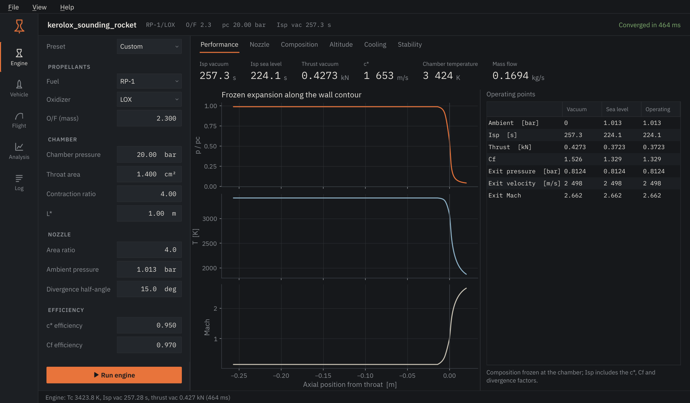

# First session

The first time EnSim starts it opens an example project, a small kerolox
sounding rocket, so that every page has something to show.

<figure markdown>

<figcaption>Engine page. Inputs on the left, results on the right, the
navigation rail at the far left.</figcaption>
</figure>

## The layout

- **Navigation rail.** Five pages: Engine, Vehicle, Flight, Analysis and Log.
  `Ctrl+1` to `Ctrl+5` jump between them.
- **Inputs.** Each page keeps its own inputs on the left. Values are stored in
  the project as soon as you leave a field.
- **Run.** The orange button at the bottom of the inputs, or `F5`, runs the
  page's main calculation. `Esc` cancels whatever is running.
- **Header.** Project name, a one-line summary of the last engine result and
  how long it took.
- **Status line.** Messages, and a thin progress line while something runs.

Calculations never block the window: you can switch pages, resize, or start
something else while a Monte Carlo study is running.

## Five minutes with the example

1. On **Engine**, press `F5`. The metrics fill in and the plots show pressure,
   temperature and Mach number along the wall contour.
2. Change *Chamber pressure* to 30 bar and run again. *Analysis → Compare*
   can pin both results side by side.
3. Open **Vehicle**. The drawing shows the centre of gravity with full and
   empty tanks and the centre of pressure. A static margin between 1 and 2
   calibres is a comfortable target.
4. Open **Flight** and press `F5`. With the example's 4 m/s westerly wind the
   rocket weathercocks to the west on the way up and drifts back east under
   its parachutes.
5. In **Flight → Dispersion**, run 100 cases to see where the rocket might land.

## Units and appearance

*View* switches between SI and US customary units, and between the dark and
light palettes. Values in the project are always stored in SI, so switching
units never changes a design. *View → Reduce motion* turns off the short
transitions.

## Files

Projects are `.ensim` files (plain JSON, see [project files](../library/project-files.md)).
*File → Export report* writes a Markdown summary; *Export results as JSON*
writes every number the session computed. Right-click any plot to save it as
PNG or SVG, or to export its data as CSV.
